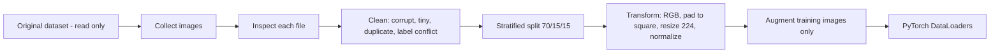

# Uncertainty-Aware Brain Tumor MRI Classification

A deep learning project that classifies brain MRI scans into four classes (glioma, meningioma, pituitary tumor, no tumor) and aims to tell **how sure** the model is and **why** it decided, so that doctors can decide when to trust it.

> This is a student research project (REVA University, Major Project Phase-1). It is not a medical device and must not be used for diagnosis.

## Why this project

Most brain tumor classifiers report only accuracy. They use a single model, give no reliable confidence, and cannot explain their decisions. In medicine, a confident wrong answer can harm a patient. This project builds toward a model that:

1. combines **two pretrained backbones with CBAM attention** (dual-branch CNN),
2. reports **uncertainty** with Monte Carlo Dropout and **calibrated confidence** with temperature scaling,
3. checks its decisions with **two explainability methods**, Grad-CAM and SHAP,
4. is compared fairly against **single-model baselines** and an **ablation study**.

## Project status

| Stage | Status |
|---|---|
| Dataset analysis | Done |
| Preprocessing pipeline (cleaning, augmentation, 70/15/15 split, DataLoaders) | Done |
| Baseline classifiers (ResNet50, EfficientNet-B0, DenseNet121) | Done |
| Dual-branch CBAM model | Code written, quick check passed, full training pending |
| Monte Carlo Dropout and temperature scaling | Planned |
| Grad-CAM and SHAP comparison | Planned |
| Ablation study and paper | Planned |

## Dataset

The assigned Brain Tumor MRI Dataset (4 classes). The public Kaggle version is here: <https://www.kaggle.com/datasets/masoudnickparvar/brain-tumor-mri-dataset>. The assigned copy has 7,200 images.

The dataset is **not stored in this repository**. Download it and pass its folder (the one that contains `Training` and `Testing`) to the scripts with `--data`.

**Results of the data analysis and cleaning on the assigned copy**

| Item | Result |
|---|---|
| Images found | 7,200 |
| Corrupt or unreadable files | 0 |
| Exact duplicate copies removed | 187 |
| Images after cleaning | 7,013 (glioma 1,786, meningioma 1,784, pituitary 1,762, no tumor 1,681) |
| Different image sizes | 447 (512x512 is the most common) |
| Colour modes | RGB, grayscale, RGBA, palette |
| Split (stratified, fixed seed) | 4,909 train, 1,052 validation, 1,052 test |

## How the data pipeline works



Key rules the pipeline follows:

- The original dataset is only **read**, never changed (checked with a fingerprint).
- Duplicates are removed **before** splitting, so no image can be in two sets (no data leakage).
- Augmentation is applied to **training data only**.
- A fixed random seed makes the splits reproducible.

## Baseline results

Fine-tuned for 3 epochs on the same splits, one run per model, evaluated once on the 1,052 test images.

| Model | Test accuracy | Macro F1 |
|---|---|---|
| ResNet50 | 96.20% | 96.22% |
| EfficientNet-B0 | 97.43% | 97.45% |
| DenseNet121 | 98.00% | 98.02% |

EfficientNet-B0 and DenseNet121 are within about 0.6 points, so they should be read as similar. Accuracy near 98% leaves little room to improve, so the value of this project is meant to come from uncertainty, calibration and explainability.

## Repository files

| File | Purpose |
|---|---|
| `analyze_dataset.py` | Quick dataset statistics and charts |
| `brain_tumor_preprocessing_pipeline.py` | Complete preprocessing pipeline with 12 built-in tests |
| `baseline_demo.py` | Train, evaluate and use a single-backbone baseline |
| `dual_branch_demo.py` | Dual-branch model with CBAM (ablation options included) |
| `README.md` | This file |

## Setup

```bash
pip install torch torchvision pillow pandas numpy scikit-learn matplotlib
```

A GPU is recommended for training. Free options: [Kaggle notebooks](https://www.kaggle.com/code) and [Google Colab](https://colab.research.google.com/).

## How to run

Run the scripts as files (for example with `python` or `!python` in a notebook). Do not paste a script into a notebook cell and run it as code, because its command-line parser will fail.

**1. Run the tests (uses a small synthetic dataset)**
```bash
python brain_tumor_preprocessing_pipeline.py --test
```

**2. Clean and split the real dataset**
```bash
python brain_tumor_preprocessing_pipeline.py --data "path/to/dataset" --out outputs
```
Put the path in quotes if it contains spaces.

**3. Train a baseline**
```bash
python baseline_demo.py train --data "path/to/dataset" --out outputs_resnet --model resnet50 --epochs 3
```
Other models: `efficientnet_b0`, `densenet121`. Add `--limit 5` for a quick test that trains on 5 batches only.

**4. Predict one scan**
```bash
python baseline_demo.py predict --image "path/to/scan.jpg" --out outputs_resnet
```

**5. Train the dual-branch model**
```bash
python dual_branch_demo.py train --data "path/to/dataset" --out outputs_dual --epochs 3
```
For the ablation study later: `--no-cbam` removes attention, `--branch-b none` uses one backbone.

## Outputs

| File | Created by | Content |
|---|---|---|
| `analysis_report.json`, `cleaning_report.json` | pipeline | Dataset statistics and what was removed |
| `removed_files.csv` | pipeline | Every removed file with the reason |
| `train.csv`, `val.csv`, `test.csv` | pipeline | The exact split lists |
| `class_distribution.png`, `split_distribution.png`, `resolutions.png` | pipeline | Charts |
| `augmentation_preview.png` | pipeline | Original vs augmented examples |
| `baseline.pt`, `baseline_results.json`, `confusion_matrix.png` | baseline | Best model, metrics, confusion matrix |
| `dual_branch.pt`, `dual_results.json`, `confusion_matrix_dual.png` | dual-branch | Same, for the dual-branch model |

## Planned next steps

1. Train the dual-branch model fully and compare it with the baselines.
2. Add Monte Carlo Dropout uncertainty with a triage rule (confident vs expert review).
3. Calibrate confidence with temperature scaling and report Expected Calibration Error.
4. Generate Grad-CAM and SHAP maps and compare them quantitatively.
5. Run the ablation study and write the paper.

## Known limitations

- One dataset and one training run per model; no external validation.
- Baselines were trained for only 3 epochs to fit free GPU time.
- Tumor masks are not available, so explanation quality will be judged by inspection on a sample.

## References

- Woo et al., *CBAM: Convolutional Block Attention Module*, ECCV 2018. <https://arxiv.org/abs/1807.06521>
- Guo et al., *On Calibration of Modern Neural Networks*, ICML 2017. <https://arxiv.org/abs/1706.04599>
- Gal and Ghahramani, *Dropout as a Bayesian Approximation*, 2016. <https://arxiv.org/abs/1506.02142>
- Selvaraju et al., *Grad-CAM*, ICCV 2017. <https://arxiv.org/abs/1610.02391>
- Lundberg and Lee, *A Unified Approach to Interpreting Model Predictions (SHAP)*, NeurIPS 2017. <https://arxiv.org/abs/1705.07874>

## Author

Trisha Srinivas (SRN R23EF286), B.Tech CSE, REVA University. Faculty guide: Prof Rishabh Kumar Chauhan.
